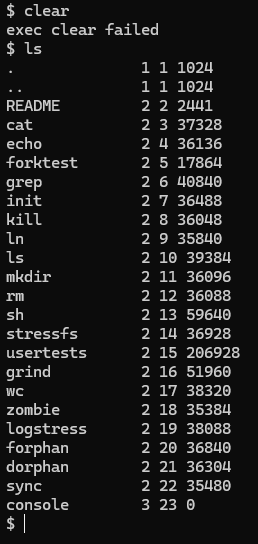
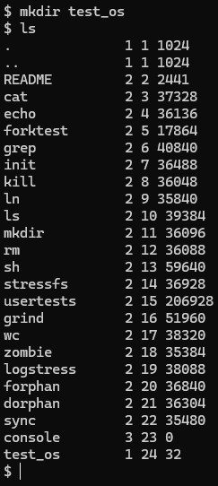
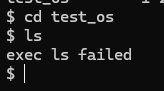
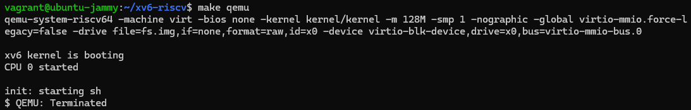
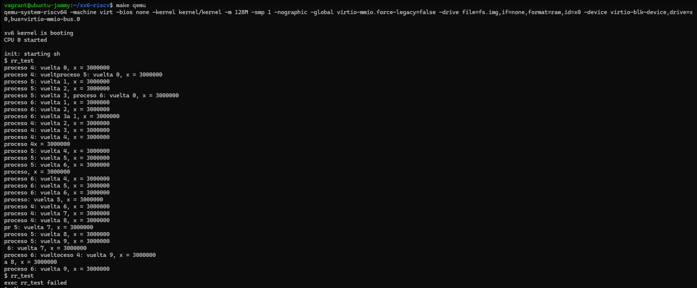
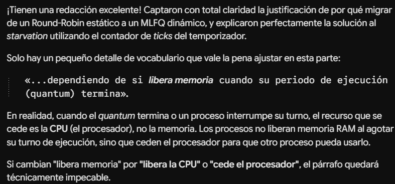
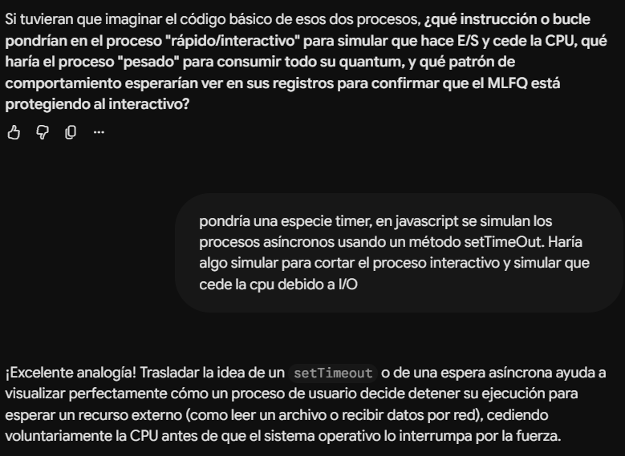
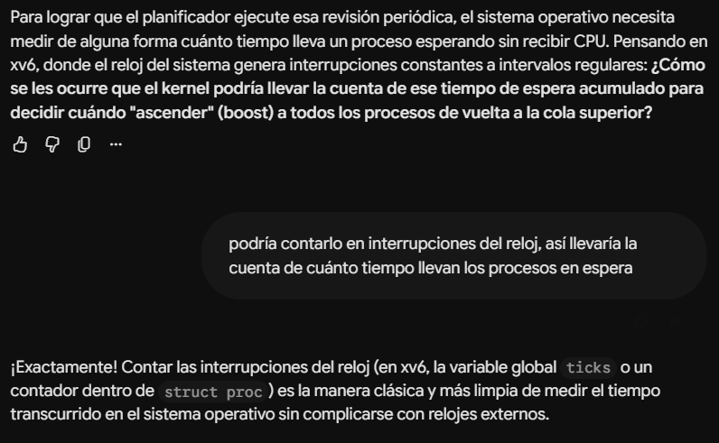

# **Integrantes**

Santiago Hurtado Rodríguez \- 202538363

Fernando Andrés Giraldo Mejía \- 2537774

# **Preparación del entorno**

## **Modelo de inteligencia artificial**

| Propiedad | Valor |
| ----- | ----- |
| Proveedor | Google Gemini |
| Modelo | Flash-Lite |

## 

## **Entorno linux**

| Propiedad | Valor |
| ----- | ----- |
| Entorno | Vagrant \+ VirtualBox |
| Distribución | Ubuntu 22.04 LTS |
| Kernel | 5.15.0-194-generic |
| Cantidad de memoria RAM | 6091 MB |
| Cantidad de núcleos | 2 |

## 

## **(1.1) Repositorio**

| Propiedad | Valor |
| ----- | ----- |
| URL | [https\://github.com/f4gm/xv6-riscv](https://github.com/f4gm/xv6-riscv) |
| Rama | riscv |
| Commit | fa2ddcb7ca87a77af579380a6eafd5aff163b44f |

## **Compilación de XV6**

**(1.2)** Según la sección “BUILDING AND RUNNING XV6” del repositorio oficial, para utilizar XV6 se debe contar con los siguientes elementos:

* RISC-V newlib tool chain from [https\://github.com/riscv/riscv-gnu-toolchain](https://github.com/riscv/riscv-gnu-toolchain)  
* qemu compiled for riscv64-softmmu

Para instalar `newlib` primero se debió correr el siguiente comando como prerrequisito:

```sh
sudo apt-get install autoconf automake autotools-dev curl python3 python3-pip python3-tomli libmpc-dev libmpfr-dev libgmp-dev gawk build-essential bison flex texinfo gperf libtool patchutils bc zlib1g-dev libexpat-dev meson ninja-build git cmake libglib2.0-dev expect device-tree-compiler libslirp-dev libzstd-dev libncurses-dev
```

Las versiones instaladas de estos paquetes son los siguientes:

```sh
autoconf        2.71-2
automake        1:1.16.5-1.3
autotools-dev   20220109.1
bc      1.07.1-3build1
bison   2:3.8.2+dfsg-1ubuntu0.22.04.1
build-essential 12.9ubuntu3
cmake   3.22.1-1ubuntu1.22.04.2
curl    7.81.0-1ubuntu1.30
device-tree-compiler    1.6.1-1
expect  5.45.4-2build1
flex    2.6.4-8build2
gawk    1:5.1.0-1ubuntu0.2
git     1:2.34.1-1ubuntu1.18
gperf   3.1-1build1
libexpat1-dev   2.4.7-1ubuntu0.9
libglib2.0-dev  2.72.4-0ubuntu2.11
libgmp-dev      2:6.2.1+dfsg-3ubuntu1
libmpc-dev      1.2.1-2build1
libmpfr-dev     4.1.0-3build3
libncurses-dev  6.3-2ubuntu0.3
libslirp-dev    4.6.1-1ubuntu0.2
libtool 2.4.6-15build2
libzstd-dev     1.4.8+dfsg-3build1
meson   0.61.2-1
ninja-build     1.10.1-1
patchutils      0.4.2-1build2
python3 3.10.6-1~22.04.1
python3-pip     22.0.2+dfsg-1ubuntu0.7
python3-tomli   1.2.2-2
texinfo 6.8-4build1
zlib1g-dev      1:1.2.11.dfsg-2ubuntu9.2
```

Posteriormente, se clona el [repositorio](https://github.com/riscv/riscv-gnu-toolchain) y se ejecuta el comando de instalación:

```sh
./configure --prefix=/opt/riscv
```

Posteriormente, ejecutamos el comando para instalar `newlib`:

```sh
sudo make
```

El proceso de compilación de `newlib` tomó un tiempo considerable, alrededor de 2.5 horas con la configuración de VM especificada al inicio.

Ahora clonamos el repositorio de [`qemu`](https://github.com/qemu/qemu.git) y cambiamos la rama a la última versión estable (`v11.1.3` en el caso del presente taller). Posteriormente, configuramos la compilación con el siguiente comando:

```sh
./configure --target-list=riscv64-softmmu --prefix=/usr/local
```

Compilamos el programa con el comando:

```sh
make -j1
```

Instalamos los binarios con:

```sh
sudo make install
```

A diferencia de `newlib`, el proceso de compilación de `qemu` tardó alrededor de 10 min.

Por último, clonamos el fork que realizamos de `XV6` y ejecutamos el comando:

```sh
make qemu
```

Con esto logramos entrar a `XV6`:





**(2.1)** En las imágenes de arriba se muestra un `ls`, posteriormente, se crea el directorio `test_os` y se vuelve a realizar un `ls` para comprobar que se haya creado correctamente. Se ingresa al directorio creado con `cd`, se hace de nuevo un `ls` y este falla, probablemente, debido a que no hay archivos en su interior.

**(2.2)** Para que `XV6` utilice una sola CPU virtual, modificamos el archivo `Makefile` con nano y establecemos la variable `CPUS` que originalmente está establecida en `CPUS := 3`, ahora en `CPUS :=1`.

Para comprobar que solamente se esté utilizando una CPU virtual, modificaremos el archivo `kernel/main.c` de la siguiente manera:

```c
#include "types.h"
#include "param.h"
#include "memlayout.h"
#include "riscv.h"
#include "defs.h"

volatile static int started = 0;

// start() jumps here in supervisor mode on all CPUs.
void
main()
{
  if (cpuid() == 0) {
    consoleinit();
    printkinit();
    printk("\n");
    printk("xv6 kernel is booting\n");
    printk("CPU %d started\n", cpuid());
    printk("\n");
    kinit();            // physical page allocator
    kvminit();          // create kernel page table
    kvminithart();      // turn on paging
    procinit();         // process table
    trapinit();         // trap vectors
    trapinithart();     // install kernel trap vector
    plicinit();         // set up interrupt controller
    plicinithart();     // ask PLIC for device interrupts
    binit();            // buffer cache
    iinit();            // inode table
    fileinit();         // file table
    virtio_disk_init(); // emulated hard disk
    userinit();         // first user process

    __atomic_store_n(&started, 1, __ATOMIC_RELEASE);
  } else {
    while (__atomic_load_n(&started, __ATOMIC_ACQUIRE) == 0)
      ;

    printk("hart %d starting\n", cpuid());
    kvminithart();  // turn on paging
    trapinithart(); // install kernel trap vector
    plicinithart(); // ask PLIC for device interrupts
  }

  scheduler();
}
```

La línea `printk("CPU %d started\n", cpuid());` imprimirá el mensaje por cada CPU que se haya iniciado. Como muestra la imagen a continuación, solo se imprime una vez el mensaje `CPU 0 started`:



# **Investigación del planificador original**

**(3. i.)** El algoritmo que usa el planificar es el round-robin. La evidencia se encuentra en la estructura del bucle dentro de scheduler. `p` vive fuera del ciclo que lo recorre. La declaración `struct proc *p;` está al inicio de la función, y `for (p = proc; p < &proc[NPROC]; p++)` avanza ese puntero. Después de `switch (&c->context, &p->context);` no hay `break` ni `return`, así que el recorrido continúa con el siguiente `slot`. Esto da el turno al siguiente proceso. El `for` externo reinicia el recorrido desde `proc` y los procesos ceden la cpu por una interrupción en el reloj.

Creamos este algoritmo para estudiar el algoritmo de planificación que usa el sistema operativo:

```c
#include "kernel/types.h"
#include "user/user.h"

int main(void) {
  for(int i = 0; i < 3; i++){
    int pid = fork();
    if(pid == 0){
      for(int k = 0; k < 10; k++){
        volatile int x = 0;
        for(int j = 0; j < 3000000; j++)
          x++;
        printf("proceso %d: vuelta %d, x = %d\n", getpid(), k, x);
      }
      exit(0);
    }
  }
  for(int i = 0; i < 3; i++)
    wait(0);
  exit(0);
}
```

Después de la ejecución, esto es lo que obtenemos:



Acá se evidencia que los procesos están corriendo en turnos rotativos. Ese ciclo es la firma del round-robin. Los bloques de cada proceso tienen tamaño similar, esto viene dado por el slice que utiliza el round-robin para turnar los procesos. Por último, los 3 procesos terminan de forma pareja, lo que demuestra que no existe ninguna prioridad entre procesos.

**(3. ii**.) La selección se implementa en `kernel/proc.c`, dentro de la función `scheduler()`. **(3. iii.)** `scheduler()` elige solo procesos `RUNNABLE` y los pasa a `RUNNING`. Un proceso deja la CPU por `yield()` (interrupción de reloj, queda `RUNNABLE`), `sleep()` (espera un evento, queda `SLEEPING`) o `exit()` (queda `ZOMBIE`), y en los tres casos vuelve al planificador mediante `sched()`. Vuelve a ser elegible cuando `yield()` lo deja `RUNNABLE` o cuando `wakeup()` lo pasa de `SLEEPING` a `RUNNABLE`.

**(3. iv**.) En XV6, `kernel/proc.c` (con `scheduler()`) y `kernel/swtch.S` se compilan a objetos `.o` mediante la regla genérica del `Makefile`. Ambos se listan en la variable `OBJS`, y la regla `$K/kernel` los enlaza con ld usando el script `kernel/kernel.ld` para generar el binario `kernel/kernel`. Ese binario es el que `make qemu` carga con `-kernel`, y al arrancar, `main()` en `kernel/main.c` termina llamando a `scheduler()`. 

**(4.)** El MLFQ es un algoritmo que utiliza el scheduler del sistema operativo para asignar prioridades de manera dinámica a los procesos. Este algoritmo es un intento de incorporar las características ventajosas de los algoritmos vistos previamente, los que priorizan el orden de llegada y los que priorizan el tiempo necesario para que el proceso termine. El algoritmo intenta prever cuánto tiempo va a durar el proceso, y basado en estos, asigna prioridades a todos los procesos que tiene en cola. No es claro para nosotros cómo funciona este proceso, cada cuánto sube la prioridad y cómo se determina la duración de cada quantum. Tampoco es claro cuántas colas existen y cómo se manejan las prioridades entre las mismas.

## **Propuesta de implementación de MLFQ**

Se debe implementar un sistema de determinación de prioridades en los procesos en kernel/proc.h en struct proc que es la estructura que almacena la información de cada proceso. Se puede agregar un campo numérico llamado “priority”. Esto es necesario para la determinación dinámica de prioridades del algoritmo, que permita recalcular la prioridad de cada proceso basado en su consumo de cpu.

Para el tiempo de espera de las colas que tienen los procesos más pesados se debe medir el tiempo que llevan esperando, puede hacerse mediante ticks del reloj que corta los procesos en el round-robin. Esto se almacena también en struct proc; se puede crear una variable “ticks” que lleve la medida de este tiempo. Esto es importante porque de otra manera tendríamos procesos totalmente estancados. Ya que no sabemos a ciencia cierta cuánto tiempo van a tomar, es necesario estar revisándolos de manera periódica para evitar que mueran de inanición.

Las piezas claves de la lógica son:

1. **Nacimiento:** Alta prioridad inicial.  
2. **Penalización:** Bajar de nivel si se agota el quantum (en el fin de turno / `yield`).  
3. **Premio:** Subir de nivel si el proceso cede voluntariamente la CPU por E/S (`sleep`).  
4. **Anti-inanición (*Aging*):** Restablecer o subir prioridades basándose en las interrupciones del reloj si llevan mucho tiempo esperando.

# **Conclusiones**

El algoritmo round-robin es eficiente en ciertos casos y bajo ciertos parámetros, pero en un ambiente más real pierde su eficacia, para esto es necesario un algoritmo que responda mejor a todas las posibilidades que existen en los procesos y reaccione de manera dinámica a esto. Este algoritmo es MLFQ, que funciona a grosso modo con un sistema de prioridades dinámico por proceso. Para aplicar este algoritmo al sistema operativo de prueba es necesario implementar varios cambios, como asignar una prioridad a cada proceso y modificarlo de manera dinámica dependiendo de si libera memoria cuando su periodo de ejecución (quantum) termina. Adicionalmente, también es importante prestar atención a los procesos que están estancados en baja prioridad, para esto se utiliza el timer que usa el round-robin para alimentar una variable "ticks", que nos mide el tiempo que lleva el proceso y basado en esto asignarle periódicamente cpu para que así logre completarse. 

# **Retroalimentación de la IA.**



## **Escenarios de implementación**



Escenario 1


Escenario 2

## **Interacciones relevantes**


Interacción relevante 1


Interacción relevante 2


Interacción relevante 3



Interacción relevante 4


# **Reflexiones individuales**

## **Santiago Hurtado**

Logré entender cómo funciona el algoritmo MLFQ para la planificación de procesos y sus características principales. La diferencia entre el algoritmo round-robin y el MLFQ y qué pasos implementar en términos de funcionalidad para pasar de round-robin a MLFQ. Conceptos importantes tales como el starving, el cpu-bound o  el aging fueron aprendidos durante la interacción con la IA. En general siento que tengo un conocimiento general bastante acertado en cuanto a las necesidades que llevan a la  implementación de un algoritmo como el MLFQ y sus implicaciones. Hay cosas muy puntuales como la asignación  y funcionamiento de las diferentes colas de procesos en los que necesito profundizar, pero a grosso modo logré entender y desarrollar el taller de manera muy fluida.

## **Fernando Giraldo**

Durante el desarrollo del taller pude fortalecer mis conocimientos sobre XV6, tanto en la preparación del entorno y la compilación del sistema operativo, que implicó instalar y configurar herramientas como RISC-V Newlib y QEMU, resolver dependencias y realizar procesos de compilación extensos, como en el estudio de los algoritmos de planificación. En particular, el análisis del MLFQ me permitió comprender sus ventajas frente al Round Robin y familiarizarme con conceptos como la asignación dinámica de prioridades, los procesos CPU-bound, el starvation y el aging, así como su influencia en la distribución del tiempo de CPU. Aunque algunos aspectos de su funcionamiento requieren mayor profundización, considero que el taller me permitió adquirir una mejor comprensión de la construcción de XV6 y de los mecanismos internos de planificación de procesos.
